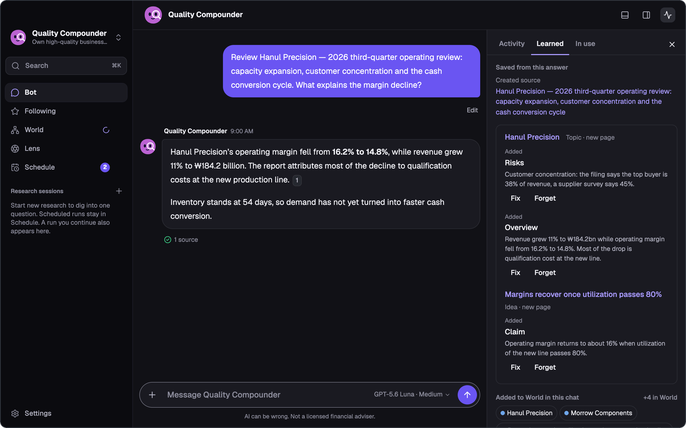
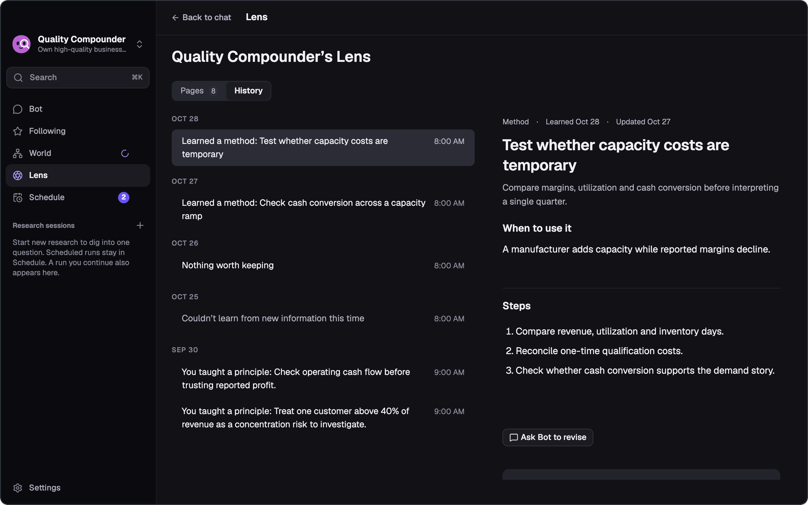
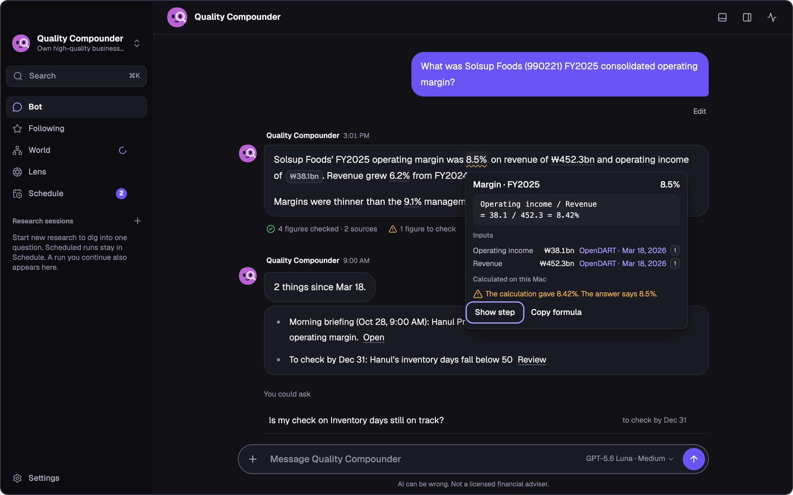
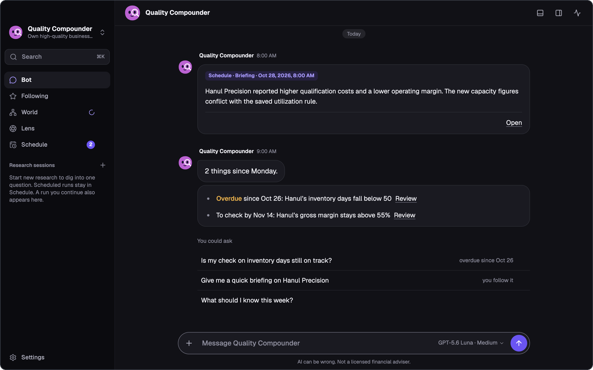

<div align="center">

<picture>
  <source media="(prefers-color-scheme: dark)" srcset="apps/loupist/assets/loupist-icon-dark.png">
  
</picture>

# Loupist

**Investment research that learns on its own.**

A research companion for investors, on your Mac. It reads filings and market data, checks each figure it cites against the source, and keeps what it learns for the next question.

macOS 13 or later on Apple Silicon · Linux x86_64 from source · free and open source · [install guide](installation.md)

<a href="https://github.com/loupistai/loupist/releases/latest/download/Loupist-macOS-arm64.dmg"></a>

By downloading Loupist you accept the [disclaimer](#disclaimer).

[](https://github.com/loupistai/loupist/actions/workflows/ci.yml)
[](https://github.com/loupistai/loupist/releases/latest)
[](LICENSING.md)
[](installation.md)
[](apps/loupist/README.md#linux)

</div>

<p>
<picture>
  <source media="(prefers-color-scheme: light)" srcset="apps/loupist/assets/readme/learned-light.png">
  
</picture>
</p>

<sub>Pictures show the app with its sample data: the companies are fictional.</sub>

## It learns from its own research

Ask a research question. Loupist reads the filings, runs the numbers and answers. Then, without being asked, it keeps what that research rested on:

- **Sources**: the filings and pages it read, with the exact passages it used.
- **World**: the names, events and relationships in those Sources, built in the background after the answer.
- **Lens**: notes on each company, asset or theme it researched, and **methods** it can work out when research sessions about different companies point to the same check.

A later question starts from all of it. The answer names the method it applied and the saved notes it read, and each one opens in Lens with its evidence.

<p>
<picture>
  <source media="(prefers-color-scheme: light)" srcset="apps/loupist/assets/readme/lens-history-light.png">
  
</picture>
</p>

<details>
<summary><b>A worked example</b> (sample data: fictional companies)</summary>

1. You ask about Hanul Precision's third-quarter operating review: *"What explains the margin decline?"* Loupist reads the review and answers. Without being asked, it keeps the review as a Source, starts a Lens page on Hanul Precision with its risks and an overview, notes an idea to test (margins recover once utilization passes 80%), and adds Hanul Precision and Morrow Components to World. That is the first picture.
2. Other research sessions look at other manufacturers adding capacity, each with its own reports.
3. Once sessions about different companies have filed their notes, Loupist reviews them together and writes a method: *Test whether capacity costs are temporary*. Lens → History records every review, including the ones that kept nothing. That is the picture above.
4. A later question about another manufacturer can apply that method; the answer names it and cites the reports it rests on.

</details>

You stay in charge of what it keeps. Read every page with its evidence and history in Lens, edit or archive it, pause learning or reset it, and turn on **Private chat** for a conversation that neither reads nor adds to Memory. And you can teach it your own rules: a **principle** you state outranks anything it learned, and an answer shows when it read one.

This is knowledge kept on your Mac that later answers read. It is not training of the AI model, and it is not a promise of better returns.

## It checks the numbers

Figures in an answer link to the passage they came from or the calculation that produced them. Loupist checks each one there and marks any that don't match, showing the answer's value, the source's value and why they differ.

<p>
<picture>
  <source media="(prefers-color-scheme: light)" srcset="apps/loupist/assets/readme/number-check-light.png">
  
</picture>
</p>

Calculations run on your Mac and show their formula and inputs; code runs in an offline Python sandbox. Charts, tables and workbooks open beside the chat and stay in the Loupist's folder. A saved Source opens at the exact passage an answer cited, and a reused figure keeps its original publisher and date.

## It works while you're away

Schedule a briefing or a research task and it runs while Loupist is open or in the menu bar; results wait in Bot, with the run history in Schedule. Hand a bigger question from Bot to its own research session and keep working; the result comes back to Bot when the session ends. Loupist can start in the menu bar when you log in, so scheduled research picks up again after a restart.

<p>
<picture>
  <source media="(prefers-color-scheme: light)" srcset="apps/loupist/assets/readme/briefing-light.png">
  
</picture>
</p>

Follow the assets you research. Each one gets a page with why you follow it, what would change your mind, and Loupist's read of how that thesis is holding up, moved one step at a time on dated evidence.

## Yours, on your Mac

- **Local.** Each Loupist is a folder on your Mac with its research sessions, Sources, World, Lens and Journal. Copy the folder to move it. There is no Loupist account, server or sync.
- **Your AI account.** Continue with ChatGPT or SuperGrok, or add an API key from Anthropic, OpenAI, Google Gemini, xAI, Upstage Solar, OpenRouter and other providers. Choose the model for each chat.
- **Read-only data.** Market data through OpenBB (SEC EDGAR filings need your contact email, FRED series a free key), World Bank, DefiLlama, Korea's OpenDART, KRX and Korea Investment, and web search.
- **Free and open source** under AGPL-3.0-only. Interface in English and Korean.

## Install

1. Download [Loupist-macOS-arm64.dmg](https://github.com/loupistai/loupist/releases/latest/download/Loupist-macOS-arm64.dmg).
2. Drag Loupist to Applications and open it. From 0.1.3 it is signed with Developer ID and notarized by Apple, so macOS only asks once to confirm an app from the internet.
3. Connect an AI account, or look around first without one.

The signed download needs macOS 13 or later on a Mac with Apple Silicon. Windows and Intel Macs are not supported. Linux x86_64 builds and runs from source. That build is not a signed release. The [installation guide](installation.md) covers checking the download and updating from 0.1.2, which asks once for access to each saved data-connection key. [Desktop development](apps/loupist/README.md#linux) covers the Linux libraries and the `.deb` build.

## Security model

| What | Where it lives or runs |
| --- | --- |
| Research sessions, Sources, World, Lens, Journal and files | A folder on your Mac, one per Loupist |
| AI sign-ins and API keys | Loupist's private app folder on your Mac |
| Data-connection keys | The macOS Keychain |
| Calculations (`run_python`) | A pinned offline Python runtime (CPython on WASI) with no shell, network, DNS, process spawn or host environment |

Loupist reads and researches. Every bundled data connection is read-only, and the app has no order-placing or brokerage-execution capability.

**What leaves your Mac, and to whom**

- **Your AI provider** receives your messages, and the Sources and saved notes an answer or World building uses. A position you mention goes with the message. Each message also carries the current time with your Mac's UTC offset and local date, but no time zone name or location. Private chat still sends the conversation to the provider.
- **Data services you enable** receive the names and tickers you follow or ask about. A listing search sends its text to OpenFIGI.
- **The web** receives the pages Loupist opens and the searches it runs, through your AI provider's own search or Exa.
- **Loupist's makers receive nothing**: no analytics or telemetry. The app checks GitHub for a signed update about once a day, and installing one always asks first.

<details>
<summary><b>How the app enforces this</b></summary>

- React submits typed intent and has no raw filesystem, process, credential or Memory-write authority.
- Rust owns Loupist isolation, credentials, persistence, Memory transactions and worker lifetimes.
- Native file tools are restricted to the Loupist's folder, scratch, attachments and bounded global-instruction paths, plus read-only bundled Skills; private app data and credentials are refused. See [Native tool permissions](docs/runtime/permissions.md).
- `run_python` is the only agent code-execution tool. It runs in a pinned WASI worker that may write only `outputs/`, its own scratch and folders the host grants, and it stays allowed after third-party text. See [Python execution](docs/runtime/permissions.md#python-execution).
- Model, market-data and Python workers run behind Rust authority; World building runs inside the app. The host owns their process lifetimes and allowed operations.
- Saving an AI key uses private process input, not a process environment. Workspace instructions and Skill entry points enter through a bounded, hash-checked snapshot.

Report a vulnerability privately as described in [SECURITY.md](SECURITY.md).

</details>

## How a Loupist remembers

<details>
<summary><b>The kinds of Memory, and where to find them</b></summary>

The sidebar shows **Bot · Following · World · Lens · Schedule**, with Settings below. World and Lens each open as a full page. World holds the Library, with **Sources · Journal · Notes** tabs. Lens holds principles, perspectives, methods, topics and ideas. Activity in a chat's header shows what the session used. Each Loupist keeps its own Memory, so a quality-compounder Loupist and a deep-value Loupist keep their own sources, knowledge and perspective.

| Kind | What it holds |
| --- | --- |
| Source | Retained material, its origin, and the exact passages used |
| World | Entities, events and relationships supported by retained Sources |
| Lens | Your principles and editable pages for perspectives, methods, topics and ideas, with evidence and revision history |
| Research note | The Loupist's saved analysis, with its evidence |
| Journal | Your own judgments, dated checks and later outcomes, with their exact inputs |

A method review starts once two research sessions about two different companies, each citing a Source the other did not, have filed notes. It runs at most once every six hours and four times a day with the World model you choose, and it may write a method, refine one or keep nothing; Lens → History records every outcome, and a revised method shows dated **Then / Now** summaries. Learning needs World building and Memory saving on, and Loupist settings has a switch for it. New Loupists build World automatically with a recommended connected model; you can change the model or pause World building in Settings. A later relevant answer must use what was learned; storing a record alone does not show learning.

The composer's **+** menu has one **Private chat** switch. With it off, a chat can read saved context, retain Sources and revise Lens; turning it on skips Memory reads and saves together. Chat history still persists and messages still go to your AI provider.

A Loupist's folder is created by the app or opened from one you already have. Quit the app and copy the whole folder, including `.loupist/`, to take a Loupist's conversations, Memory and retained originals with you. The list of assets you follow stays in the app on that Mac. Removing a Loupist from the app leaves its folder available to reopen.

See [Knowledge and Memory](docs/knowledge-model.md) for the full model.

</details>

## Develop

Loupist is a [Tauri 2](https://tauri.app) app: a Rust host that owns storage, credentials and permissions; a React and TypeScript interface; the [Pi](https://github.com/earendil-works/pi) agent runtime; SQLite in each Loupist folder; CPython on Wasmtime for `run_python`; a bundled OpenBB worker for market data; and a local multilingual embedding model for World search.

You need Node.js 26.13 or later in the 26.x line (see `.nvmrc`), Python 3.12 with `uv`, and Rust (CI pins 1.97.1). On an Apple Silicon Mac:

```sh
cd apps/loupist
sh scripts/setup.sh && sh scripts/stage-macos-arm64.sh
npm run tauri dev
```

Development builds keep their data in `~/.loupist/development/` and never open the installed app's data. [Desktop development](apps/loupist/README.md) covers the rest, [native UI testing](apps/loupist/e2e/README.md) drives the real app, and the [repository guide](docs/README.md) maps every topic. On Linux x86_64, install the [WebKitGTK 4.1 build libraries](docs/dev/checks.md#linux-cloud-development) and run `sh scripts/setup.sh` and `npm run tauri dev` from `apps/loupist`. `npm run tauri build` writes a `.deb`. The signed release target remains macOS on Apple Silicon.

`scripts/verify.sh` is the clean-checkout gate: it installs locked dependencies and runs the web, Rust and Python checks. With dependencies installed, `npm run check --prefix apps/loupist` runs the app checks without reinstalling. Before a pull request, run `scripts/verify.sh --affected` to check the scopes your change selects, as CI does. [Release acceptance](LOUPIST.md) lists the journeys a release must pass.

## Contribute

Bug reports and ideas go to [Issues](https://github.com/loupistai/loupist/issues). For code, read [CONTRIBUTING.md](CONTRIBUTING.md): branch from `main`, sign off each commit (`git commit -s`), and agree to the [Contributor License Agreement](CLA.md). Coding agents start from [AGENTS.md](AGENTS.md).

## License

Loupist is licensed under [AGPL-3.0-only](LICENSE). See [Licensing](LICENSING.md) for app code, contributions, shared packs and provider data, and [Trademarks](TRADEMARKS.md) for the project name and logo.

## Disclaimer

Loupist is research software, provided free of charge and "as is" under the AGPL-3.0 licence, without warranty of any kind.

It is not a licensed investment adviser, broker or dealer. Nothing it produces is investment, legal or tax advice, or a recommendation to buy, sell or hold anything.

AI output can be wrong, incomplete or out of date, and so can data from the services you connect. Check anything you rely on against its source.

You alone are responsible for how you use Loupist and for every decision you make with it, including any investment loss.

You are also responsible for your accounts, API keys and data, for the security of your Mac, and for following the terms of the AI and data services you connect.

To the fullest extent the law allows, the authors and contributors are not liable for any loss or damage arising from the use of this software.
