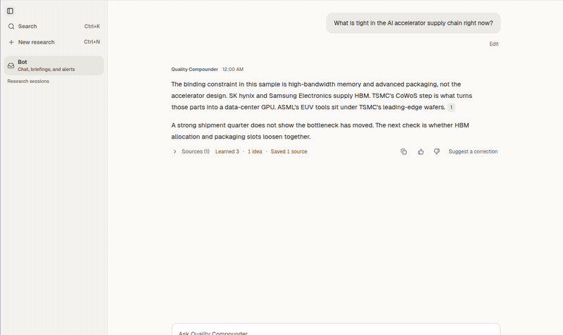
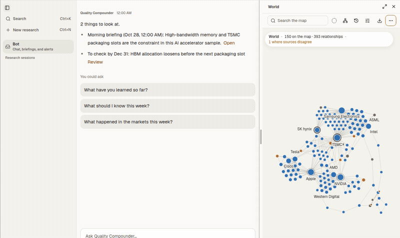
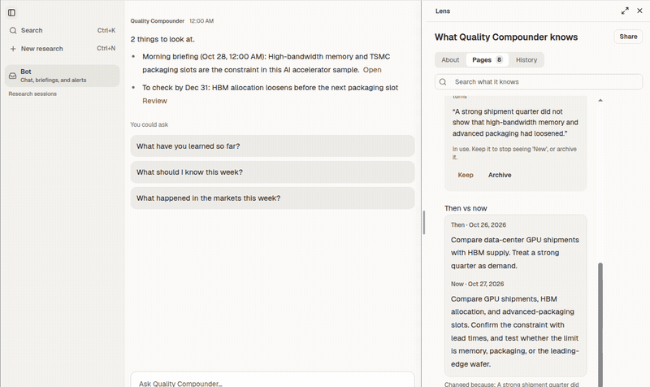

# Loupist

**Watch. Remember. Explain.**

A Loupist watches what you follow, remembers how you research, and explains what changed with the source attached. It runs on your Mac. It never trades.

## Ask where AI supply is tight

You ask what is tight in the AI accelerator chain. The answer cites the note it used. The note in this clip is a sample, not a filing.

## Open the chip World

World is the map of that chain. This sample draws 150 names and 393 relationships at once. NVIDIA, TSMC, SK hynix, Samsung Electronics, and ASML sit in it, with high-bandwidth memory and advanced packaging. The names are public companies used as sample context. One link is marked where sources disagree.

## Revise the Lens

Lens holds the check. Then vs now keeps the earlier wording beside the one it uses now. This method learns to separate durable AI-chip demand from a temporary packaging bottleneck. The wording is sample research.

## What stays on your machine

The research lives in a folder you choose. `.loupist/` keeps the chats and memory. Copy that whole folder, including `.loupist/`, to move a Loupist. There is no Loupist account and no sync. Answers use a provider API key or an account sign-in on this Mac. Scheduled briefings run only while the app is running.

Learning means retained sources and revised methods. It does not train model weights. It does not promise returns.

## Install

The first release is macOS 13 or newer on Apple Silicon. Windows, Intel Macs, and Linux are outside this release. Signed installers will be published on [GitHub Releases](https://github.com/loupistai/loupist/releases). Until an installer is available, follow [installation](installation.md).

## Security model

- React submits typed intent and has no raw filesystem, process, credential, or Memory-write authority.
- Rust owns Loupist isolation, persistence, and Memory writes.
- Local file and Bash tools are trusted execution with your OS permissions. The selected folder is their working directory, not a sandbox. Bash children receive a filtered environment without app credentials. Local host files remain accessible.
- Model, market-data and graph workers run behind Rust authority. The host owns their process lifetimes and allowed operations.
- Memory is the Loupist's durable learned state. Bundled Skills define product methods. Workspace instructions and Skill entrypoints enter through a bounded, hash-checked snapshot.

Desktop setup and checks live in [desktop development](apps/loupist/README.md).

Loupist is an AI research companion. It can share a view when you ask. It is not a licensed adviser, and it never places a trade.

Loupist is licensed under AGPL-3.0-only. See [Licensing](LICENSING.md).
